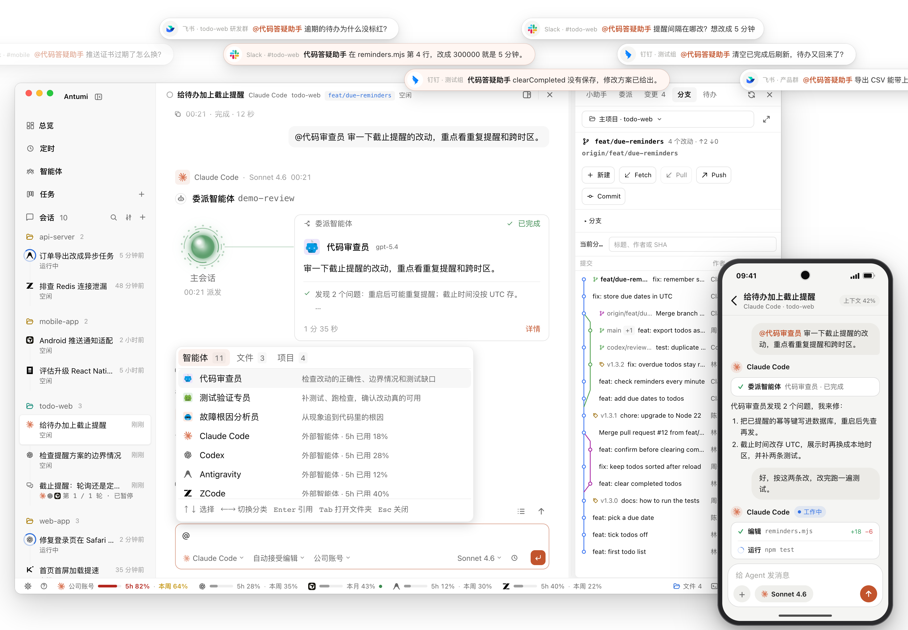
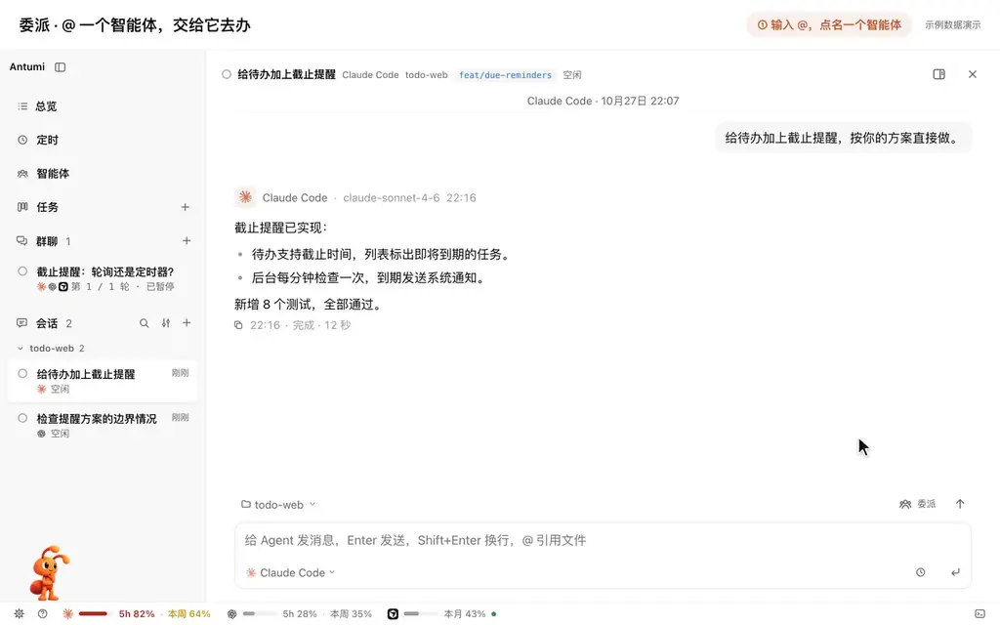
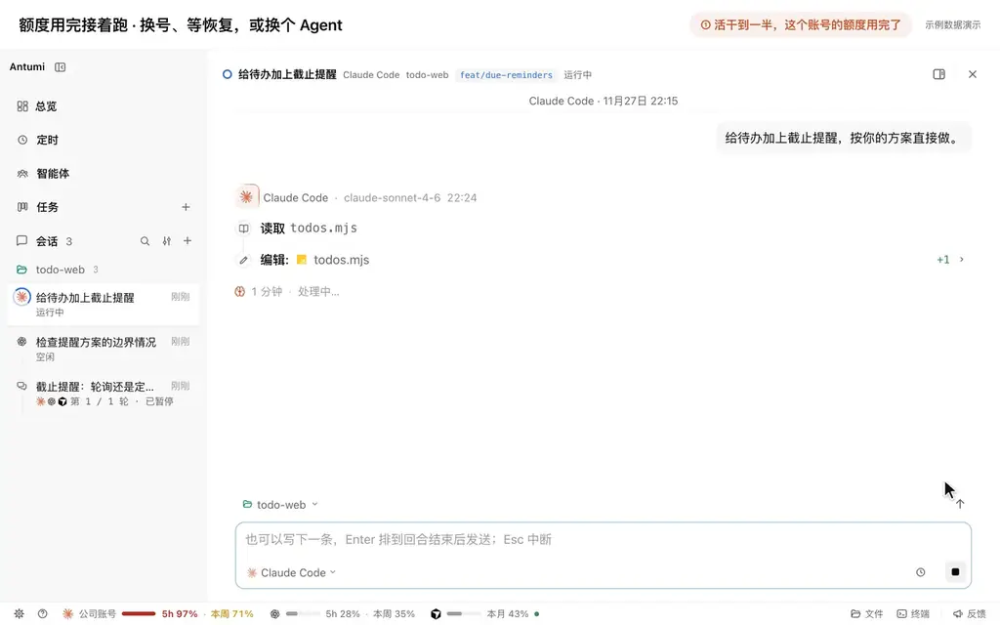
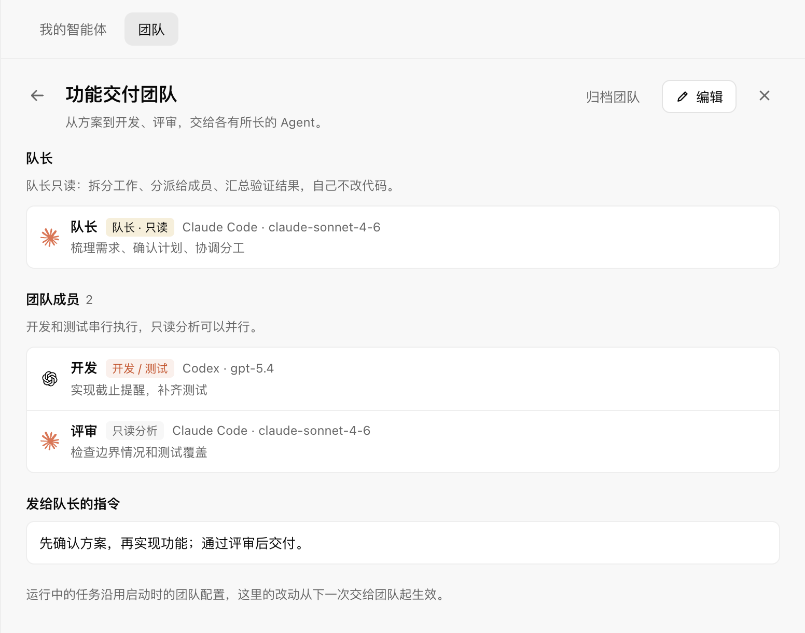
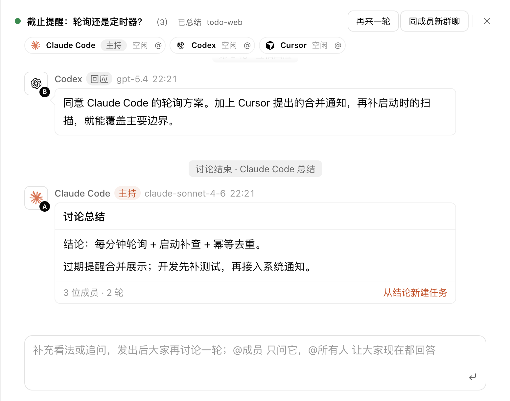

<div align="center">

# Antumi

### Your agents, on call for you.

Antumi is a desktop workbench: it takes on new tasks and bugs as they come in, answers colleagues' questions about the code in team chat, and switches accounts to keep going when quota runs out.<br>It uses the Claude Code and Codex you already have installed, with no new sign-in.

[](https://github.com/flyhero/antumi/releases)
[](https://github.com/flyhero/antumi/releases)


[](docs/MOBILE.md)
[](LICENSE)

**[Download the latest](#download) · [Start in three minutes](#start-in-three-minutes)**

[What it does](#what-it-does) · [Supported agents](#supported-agents) · [Also included](#also-included) · [FAQ](#faq)

[简体中文](README.md) · **English**

<p align="center">
  <a href="#supported-agents" title="Claude Code"></a>&nbsp;&nbsp;
  <a href="#supported-agents" title="Codex"></a>&nbsp;&nbsp;
  <a href="#supported-agents" title="Cursor"></a>&nbsp;&nbsp;
  <a href="#supported-agents" title="OpenCode"></a>&nbsp;&nbsp;
  <a href="#supported-agents" title="Pi"></a>&nbsp;&nbsp;
  <a href="#supported-agents" title="DeepSeek Harness"></a>&nbsp;&nbsp;
  <a href="#supported-agents" title="Antigravity"></a>&nbsp;&nbsp;
  <a href="#supported-agents" title="ZCode"></a>&nbsp;&nbsp;
  <a href="#supported-agents" title="Kimi Code"></a>&nbsp;&nbsp;
  <a href="#supported-agents" title="Gemini CLI"></a>&nbsp;&nbsp;
  <a href="#supported-agents" title="CodeBuddy"></a>&nbsp;&nbsp;
  <a href="#supported-agents" title="CodeArts"></a>
</p>



**One minute:** three bugs, from the inbox all the way to a merge.

https://github.com/user-attachments/assets/74747188-10e9-4d1d-b444-86c867f25c58

</div>

## What it does

You already use Claude Code, Codex or another agent CLI in a terminal. Antumi stands in front of them: it brings the work in, hands it to the right agent, and gathers everything that needs your sign-off in one place.

The four things below come first; click an image to see it full size. The rest is under [Also included](#also-included), and setup steps are in the [user guide](docs/GETTING-STARTED.en.md).

<table>
<tr>
<td width="38%" valign="middle">

### New tasks and bugs are taken on for you

A new task or bug in a source goes first to an agent you pick for a look. Whether it only reports back or opens a task to fix it, and whether it writes back to the original issue, is up to you.

[Connect a source](docs/GETTING-STARTED.en.md#task-sources) · [Automation](docs/SOURCE-AUTO-INVESTIGATION.md) (Chinese) · [Writeback](docs/SOURCE-WRITEBACK.md) (Chinese)

</td>
<td width="62%">
<a href="docs/assets/features/investigate.webp"></a>
</td>
</tr>
<tr>
<td width="38%" valign="middle">

### Colleagues ask in team chat, it answers for you

Colleagues mention the agent in Feishu, Lark, DingTalk or Slack, and it reads the code to answer. It reads and never changes anything, sees only the projects you picked, and who asked what is on record.

[Set it up](docs/GETTING-STARTED.en.md#let-colleagues-ask-on-slack-feishu-or-dingtalk) · [What it can reach](docs/CHANNELS.md#信任模型) (Chinese)

</td>
<td width="62%">
<a href="docs/assets/features/channel.webp"></a>
</td>
</tr>
<tr>
<td width="38%" valign="middle">

### Several agents on one job

Type `@` to hand a piece of work to another agent; the result comes back to the main conversation on its own. Bigger work goes to a team, and a plan not yet settled starts in a group chat.

[Delegation](docs/ARCHITECTURE.md#智能体与委派) · [Teams](docs/ARCHITECTURE.md#团队) · [Group chat](docs/ARCHITECTURE.md#群聊) · [Handoff](docs/GETTING-STARTED.en.md#handoff)

</td>
<td width="62%">
<a href="docs/assets/features/delegate.webp"></a>
</td>
</tr>
<tr>
<td width="38%" valign="middle">

### Quota runs out, work keeps going

With another account, it switches and the same conversation carries on. Without one, it waits for the quota to reset and continues, or you hand off to another agent.

[Multiple accounts](docs/GETTING-STARTED.en.md#multiple-accounts) · [Scheduling](docs/GETTING-STARTED.en.md#scheduling-send-when-quota-resets-or-at-a-set-time) · [Usage](docs/USAGE-ANALYTICS.md)

</td>
<td width="62%">
<a href="docs/assets/features/resume.webp"></a>
</td>
</tr>
</table>

<details>
<summary><b>Delegation, teams or group chat?</b></summary>

| | Delegation | Team | Group chat |
|---|---|---|---|
| **For** | A separate piece of work: a review, tests, a root cause | One job that needs splitting up | Talking the plan through before anyone builds |
| **Start** | Type `@` in the composer and pick a ready agent or a saved one | Give the task to a team | New group chat, pick 2–5 members |
| **Changes code** | Read-only analysis, or development in its own worktree; both can run at once | Developers change it, a lead splits the work, a reviewer checks it | No one; discussion only |
| **Result** | Comes back to the main conversation | All in one worktree, waiting for your review | The host sums up; you can start a task from the conclusion |

<table>
  <tr>
    <td width="50%" valign="top">
      <p><strong>Team</strong><br /><sub>Lead, developer and reviewer, each with its own agent and model</sub></p>
      <a href="docs/assets/readme/squad.png"></a>
    </td>
    <td width="50%" valign="top">
      <p><strong>Group chat</strong><br /><sub>Each answers, they respond to each other, and the host sums up</sub></p>
      <a href="docs/assets/readme/discussion.png"></a>
    </td>
  </tr>
</table>

</details>

## Download

Every installer is in the [latest release](https://github.com/flyhero/antumi/releases/latest), for macOS, Windows and Linux. Each brings its own runtime; you do not need Node.

<details>
<summary><b>Which file for your system, and what to do the first time (macOS needs the quarantine attribute cleared)</b></summary>

| System | Download the file ending in | First launch |
|---|---|---|
| macOS · Apple Silicon | `macos-arm64.dmg` | Drag it to Applications, then clear the quarantine attribute (below) |
| macOS · Intel | `macos-x64.dmg` | Same as above |
| Windows · x64 | `windows-x64.exe` | SmartScreen stops it once: choose More info → Run anyway |
| Linux · x64 | `linux-amd64.deb`<br>`linux-x86_64.AppImage` | Install the deb with `sudo apt install ./<file>`; make the AppImage executable and run it |
| Android | `android-arm64-v8a.apk` | In the [phone app releases](https://github.com/flyhero/antumi/releases?q=mobile-v&expanded=true); once installed, [pair it with the computer](docs/GETTING-STARTED.en.md#on-your-phone) |

The macOS app is ad-hoc signed only. After installing, run this once:

```bash
xattr -dr com.apple.quarantine /Applications/Antumi.app
```

**macOS notifications.** Do not run the app from the dmg, or system notifications will not be delivered. Choose Allow the first time a notification is sent; if you miss it, open System Settings → Notifications → Antumi, turn on Allow Notifications, and set the style to Banners or Alerts. If you would rather not use the command, double-click once so it is blocked, then choose Open Anyway under System Settings → Privacy & Security. Troubleshooting is in [Packaging and install](docs/ARCHITECTURE.md#8-打包与安装) (Chinese).

**Linux.** Ubuntu 22.04 and later need `sudo apt install libfuse2` before the AppImage runs. On Ubuntu 23.10 and later, a sandbox error means use the deb, or start with `--no-sandbox`.

**Android.** If a very old 32-bit phone cannot install `arm64-v8a`, download the `armeabi-v7a` one instead.

</details>

## Start in three minutes

Install and sign in to at least one agent CLI first. On first launch, Antumi checks whether each is installed and usable.

1. **Give it a small task.** In the sidebar, open Tasks and click +, pick a project and an agent, write one line about what should change, and click Start. Antumi creates a worktree of its own; the agent proposes a plan first and changes code only after you approve it.
2. **Go do something else.** A system notification arrives when it is done or waiting for you, and everything waiting on you is in the Overview.
3. **Review.** In the inspector on the right, read the diff of the whole branch, run the project's checks, and have the agent open the page in the built-in browser. Merge when you are satisfied.

For what comes next, each has its own section: [connect an issue source](docs/GETTING-STARTED.en.md#task-sources) · [add accounts](docs/GETTING-STARTED.en.md#multiple-accounts) · [connect a chat platform](docs/GETTING-STARTED.en.md#let-colleagues-ask-on-slack-feishu-or-dingtalk) · [connect your phone](docs/GETTING-STARTED.en.md#on-your-phone) · [use a coding plan or custom endpoint](docs/GETTING-STARTED.en.md#model-providers). In the app it is also under Help → User guide.

Routines, scheduled sends, automation and chat-platform answers only run while the computer is awake; the coffee cup in the status bar keeps it awake.

## Supported agents

Twelve: Claude Code, Codex, Cursor, OpenCode, Pi, DeepSeek Harness, Antigravity, ZCode, Kimi Code, Gemini CLI, CodeBuddy and CodeArts. Use whichever you have installed; any of them can hand off to another, and any can be delegated to with `@`.

<details>
<summary><b>Each agent's permission modes and what it supports</b></summary>

| Agent | Common permission modes | Plan approval | Read-only delegation | Routines / scheduling | Account switching |
|---|---|:-:|:-:|:-:|:-:|
| [**Claude Code**](https://github.com/anthropics/claude-code) | Ask each time · Accept edits · Plan · Automatic | ✓ | ✓ | ✓ | ✓ |
| [**Codex**](https://github.com/openai/codex) | Ask each time · Automatic · Plan · Read only | ✓ | ✓ | ✓ | ✓ |
| [**Cursor**](https://cursor.com/cli) | Agent · Plan · Ask | ✓ | ✓ | — | — |
| [**OpenCode**](https://opencode.ai) | Build · Automatic · Plan · Read only | — | ✓ | ✓ | — |
| [**Pi**](https://pi.dev) | Default · Automatic · Plan · Read only | ✓ | ✓ | ✓ | — |
| [**DeepSeek Harness**](docs/DEEPSEEK.md) | Default · Automatic · Plan · Read only | ✓ | ✓ | ✓ | — |
| [**Antigravity**](docs/ANTIGRAVITY.md) | Default · Auto Edit | — | — | — | ✓ |
| [**ZCode**](docs/ZCODE.md) | Ask before changes · Edit freely · Plan · Autonomous · Read only | ✓ | ✓ | ✓ | — |
| [**Kimi Code**](docs/KIMI.md) (Node.js 2.3.2+) | Default · Plan · Auto | ✓ | ✓ | ✓ | — |
| [**Gemini CLI**](docs/GEMINI.md) (0.66.0+) | Default · Auto Edit · Plan | ✓ | — | ✓ | — |
| [**CodeBuddy**](docs/CODEBUDDY.md) | Always Ask · Accept Edits · Plan · Auto | ✓ | — | ✓ | ✓ |
| [**CodeArts**](docs/CODEARTS.md) | Build · Automatic · Plan · Read only | — | ✓ | ✓ | — |

- An agent marked — for read-only delegation can only be delegated work that may change code.
- In conversations you run yourself, Allow everything is never selected by default. Unattended runs such as routines and scheduled sends default to Allow everything on a fresh install; switch to the more cautious Careful under Settings → Permissions.
- ZCode uses the desktop app or `zcode-app-cli`; Antigravity is downloaded under Settings → External agents. That page also lists agent CLIs Antumi recognises but does not drive yet.
- How each agent is connected is in [Architecture](docs/ARCHITECTURE.md) (Chinese) and [Adding a new Agent](docs/ADDING-AN-AGENT.en.md).

You can also skip the official account: under Settings → Model providers, connect a coding plan such as Volcengine Ark, Zhipu or Kimi, or a custom endpoint, and import an existing CC Switch setup as it is. Cursor cannot use a provider. Using a subscription account through a proxy may break its terms and get the account banned; see the [user guide](docs/GETTING-STARTED.en.md#model-providers).

</details>

## Also included

| | |
|---|---|
| **Phone app** | On an Android phone, read conversations, answer requests, send messages and images, create and start tasks. Agents still run on the computer. Off the same Wi‑Fi, go through Tailscale or your own server. [Docs](docs/GETTING-STARTED.en.md#on-your-phone) |
| **Routines and scheduling** | Run daily, on weekdays or weekly, or hold a message until a set time. Cursor and Antigravity are not supported yet. [Docs](docs/GETTING-STARTED.en.md#scheduling-send-when-quota-resets-or-at-a-set-time) |
| **Agents** | Save a role, a model, skills and MCP servers as one of My agents. Chat with it, delegate to it with `@`, add it to a team, or pin it to the sidebar. [Docs](docs/ARCHITECTURE.md#智能体与委派) (Chinese) |
| **Split view** | Hold ⌘ and click another conversation: implement on one side, read another agent's advice on the other. [Docs](docs/GETTING-STARTED.en.md#split-view-two-conversations-side-by-side) |
| **Files, terminal, browser** | Edit files, watch the dev server and check pages in the workspace. Agents can open pages and read the console themselves. Each panel can be dragged out into its own window. |
| **Helper and translation** | Select a passage and hand it to the helper to explain, or translate a reply into your language. A lightweight model does it, outside the main conversation's context. [Docs](docs/GETTING-STARTED.en.md#helper-and-translation) |
| **To-dos** | An agent records what you need to do later; tick items off in the inspector. The Overview lists them across conversations. [Docs](docs/ARCHITECTURE.md#待办) (Chinese) |
| **References and a knowledge base** | Type `@` to cite a file, a project or an earlier conversation. An agent can write notes into your Markdown or Obsidian vault. [Docs](docs/GETTING-STARTED.en.md#cross-conversation-references) |
| **Chat commands** | Save a prompt you use often as a command, and pin up to three above the composer to send with one click. |
| **Backend elsewhere** | Projects and agents in WSL, or on a Linux server: move the backend there under Settings → Backend location, and keep the interface on your machine. [WSL](docs/GETTING-STARTED.en.md#projects-and-agents-live-in-wsl-windows) · [Remote server](docs/REMOTE.md) (Chinese) |
| **Usage** | Totals over a period, and an estimate of when quota runs out. [Docs](docs/USAGE-ANALYTICS.md) |

Shortcuts you will use: <kbd>N</kbd> on the board to note a task, <kbd>⌘</kbd><kbd>K</kbd> to search, <kbd>⌘</kbd><kbd>E</kbd> / <kbd>⌘</kbd><kbd>J</kbd> / <kbd>⌘</kbd><kbd>L</kbd> for files, the terminal and the browser. All can be changed under Settings → Keyboard shortcuts.

## Where your data lives

- **All on your computer.** Tasks, conversations and settings are kept in `~/.antumi/`. The backend listens only on `127.0.0.1` and needs this machine's token to connect; only when you turn on phone access does it open a second port, for paired phones.
- **Secrets are kept apart.** Task source tokens are stored in a file with mode 600 and handed only to their own source, never back to the interface and never to an agent.
- **Phone to computer is end-to-end encrypted.** Through your own relay server, the server only forwards ciphertext it cannot read.
- **The agent in team chat is read-only.** It can read only files in the projects you picked that `.gitignore` does not exclude, and nothing else on this computer.

Details are in [Architecture](docs/ARCHITECTURE.md), [Phone app](docs/MOBILE.md) and [Chat platforms](docs/CHANNELS.md#信任模型) (all Chinese).

## FAQ

<details>
<summary><b>Do I need to buy an API or sign up for an account?</b></summary>

No. Antumi uses each agent CLI's own sign-in and subscription, and has no account of its own. Add a coding plan or custom endpoint under Settings → Model providers only if you want one.

</details>

<details>
<summary><b>Does it change my CLI's configuration? Can I still use it in a terminal?</b></summary>

Yes, as before. Extra accounts and providers are injected as environment variables each time an agent starts; the agent's own configuration is left alone. A conversation half done in a terminal can be imported into Antumi and continued.

</details>

<details>
<summary><b>Do agents stop when I close the window?</b></summary>

No. Agents run in a background process, and closing the window does not interrupt them. A sleeping computer does: routines, scheduled sends, automation and chat-platform answers all need it awake.

</details>

<details>
<summary><b>Does it work with WSL or a remote Linux machine?</b></summary>

Yes. Under Settings → Backend location, move the backend into a WSL distribution or onto a Linux server; tasks, conversations and agents then run there, and the interface stays on your machine. A remote server is reached over SSH, and Antumi installs Node there if it is missing; WSL is offered only in the Windows app. See [WSL](docs/GETTING-STARTED.en.md#projects-and-agents-live-in-wsl-windows) and [Remote server](docs/REMOTE.md) (Chinese).

</details>

<details>
<summary><b>How do I run it from source?</b></summary>

You need Node ≥ 22.13 and pnpm 12.

```bash
git clone https://github.com/flyhero/antumi.git
cd antumi
pnpm install
ANTUMI_HOME=~/.antumi-demo pnpm dev
```

`ANTUMI_HOME` points at a test directory so your real data stays untouched. Packaging steps are in [Releasing](docs/RELEASING.md).

</details>

## Community & Support

<table>
  <tr>
    <td>
      <strong>WeChat group</strong><br />
      <sub>Scan to join: usage, feedback and updates.</sub>
      <ul>
        <li><sub>If something feels awkward, or you want another agent connected, open an <a href="https://github.com/flyhero/antumi/issues">issue</a></sub></li>
        <li><sub>Thanks to the <a href="https://linux.do">LINUX DO</a> and <a href="https://www.v2ex.com">V2EX</a> communities for their support</sub></li>
      </ul>
    </td>
    <td align="center">
      
    </td>
  </tr>
</table>

## Contributing

Antumi keeps getting better as more people join in. You are welcome to help improve it, even if it is just opening an [issue](https://github.com/flyhero/antumi/issues) or fixing a line in the docs; have a look at [Contributing](CONTRIBUTING.md) before you start. We hope to see you among the contributors.

<a href="https://github.com/flyhero/antumi/graphs/contributors">
  
</a>
