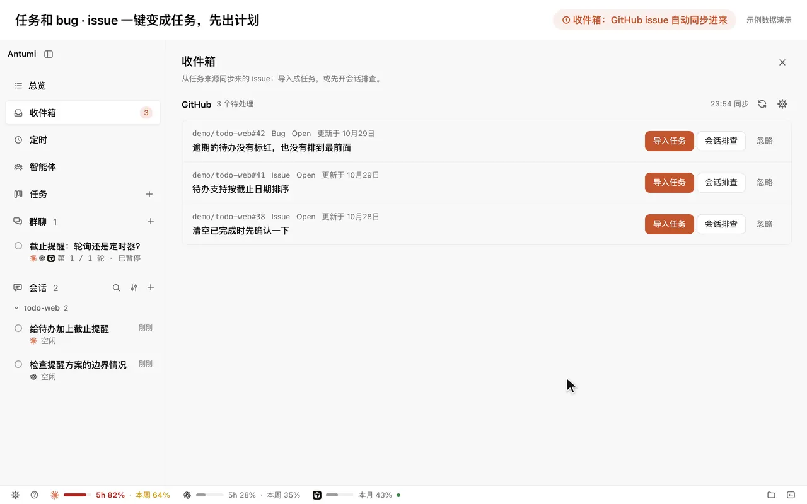
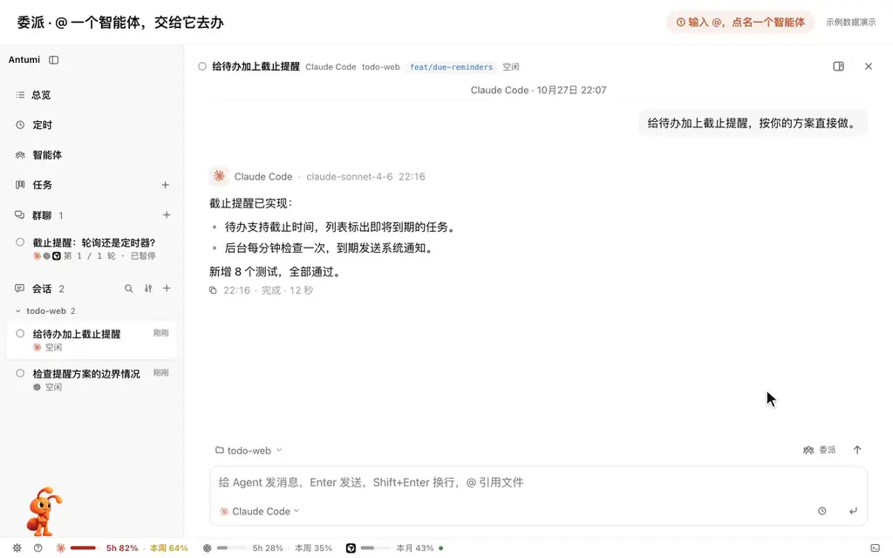
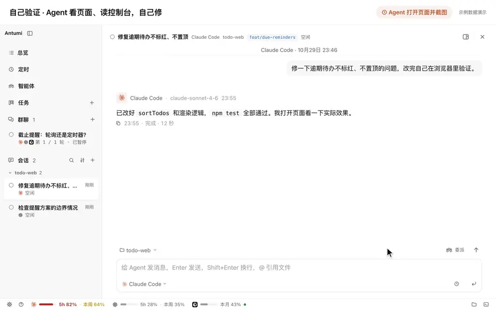
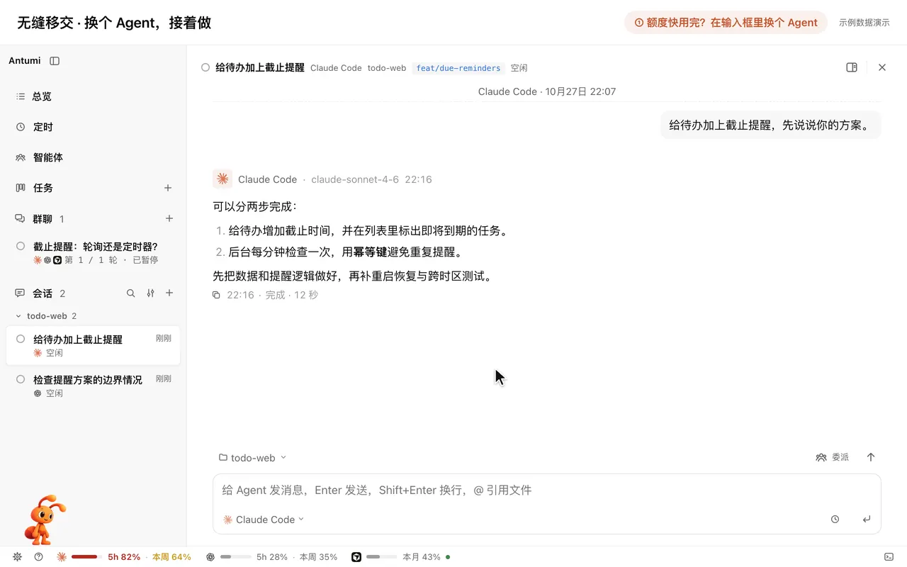

<div align="center">

# Antumi

**Get the Claude Code, Codex and other agents you already have working together, through to your review.**

A local desktop app. It drives the agent CLIs you are signed in to: one implements, another reviews, the work is checked in the built-in browser, and you merge the result. No setup or login to redo.

Issues straight to work · Agents working together · Self-verification · Keeps going when quota runs out

[](https://github.com/flyhero/antumi/releases)
[](https://github.com/flyhero/antumi/releases)

[](LICENSE)

[Download](https://github.com/flyhero/antumi/releases) · [Start in three minutes](#start-in-three-minutes) · [Compared with a terminal](#compared-with-opening-a-terminal) · [Supported agents](#supported-agents) · [Docs](#docs)

[简体中文](README.md) · **English**

<p align="center">
  <a href="#supported-agents" title="Claude Code"></a>&nbsp;&nbsp;
  <a href="#supported-agents" title="Codex"></a>&nbsp;&nbsp;
  <a href="#supported-agents" title="Cursor"></a>&nbsp;&nbsp;
  <a href="#supported-agents" title="OpenCode"></a>&nbsp;&nbsp;
  <a href="#supported-agents" title="Pi"></a>&nbsp;&nbsp;
  <a href="#supported-agents" title="DeepSeek Harness"></a>&nbsp;&nbsp;
  <a href="#supported-agents" title="Antigravity"></a>&nbsp;&nbsp;
  <a href="#supported-agents" title="ZCode"></a>&nbsp;&nbsp;
  <a href="#supported-agents" title="Kimi Code"></a>&nbsp;&nbsp;
  <a href="#supported-agents" title="Gemini CLI"></a>
</p>

**One minute:** three bugs, from the inbox all the way to a merge.

https://github.com/user-attachments/assets/74747188-10e9-4d1d-b444-86c867f25c58

</div>

This is a development release (0.21.x), built and tested mainly on macOS. Windows and Linux can be installed and packaged. The interface can be English or Simplified Chinese. The launch video (narrated in Chinese) and the demos use sample data, with the interface in Chinese.

## Who it's for

You already use Claude Code, Codex or another agent CLI in a terminal, and you want them to take a piece of work from a plan through to review, without copying between windows.

Antumi does not replace those CLIs, and it does not ask you to sign in again. A session you started in a terminal can be imported and continued.

## Compared with opening a terminal

The four sections below are the path from a task to finished work. Everything else is under [Also included](#also-included). Details are in the [user guide](docs/GETTING-STARTED.en.md).

### Start from an issue

Issues from GitHub, Jira, Linear and ZenTao sync into the sidebar inbox and import as tasks in one step. Starting creates a worktree and a branch named with the issue number. The agent reads the code and proposes a plan; it changes code only after you approve. A bug whose cause is still unclear can be investigated first. Tasks can depend on each other: the next one unlocks when the previous one passes review.

[Connect a source](docs/GETTING-STARTED.en.md#task-sources) · [How tasks flow](docs/ARCHITECTURE.md#2-任务模型)



### Several agents on one job

Five windows means switching between them to see who is waiting for approval and who is done. In Antumi, type `@` in the composer to hand work to another agent that is ready on this machine, or to a saved role (a code reviewer, a test verifier). The sub-session works on its own, and the result comes back to the main conversation. Read-only analysis, and development in its own worktree, can run at the same time.

Bigger work can go to a team: a lead splits it up, a developer builds it, a reviewer checks it.

Each task gets its own worktree, so the code does not collide. Approvals, questions and reviews sit together in the overview. You get a system notification when an agent finishes or is waiting for you.

[Delegation](docs/ARCHITECTURE.md#智能体与委派) · [Teams](docs/ARCHITECTURE.md#团队) · [Handoff](docs/GETTING-STARTED.en.md#handoff)



### It checks first, then you review

The agent opens the page in the built-in browser, clicks, reads the console and network requests, and takes screenshots. It watches the dev server in the built-in terminal and keeps fixing what it finds. You can take over the page at any time, or add a selected element or a screenshot to the conversation. When it is done, look at the diff of the whole task branch, run the project's checks, and merge when you are satisfied.

[Built-in browser](docs/ARCHITECTURE.md#5-内置浏览器) · [After review](docs/ARCHITECTURE.md#验收之后)



### When quota runs out, it continues

With more than one Claude Code or Codex account, a used-up quota switches to the next account and the same conversation keeps going. With no account left to switch to, it waits for the quota to reset and then continues, or you hand the conversation to another agent. You can also hold the next message until quota resets or until a set time. The status bar shows each agent's usage and when it resets.

[Several accounts](docs/GETTING-STARTED.en.md#multiple-accounts) · [Scheduling](docs/GETTING-STARTED.en.md#scheduling-send-when-quota-resets-or-at-a-set-time) · [Quota pacing](docs/ARCHITECTURE.md#额度节奏与建议)



## Your data stays on your machine

Worth knowing before you install:

- Tasks, conversations and worktrees live in `~/.antumi/`. The core features do not depend on a service hosted by Antumi.
- core listens on `127.0.0.1` only, and every connection needs the local token.
- Agents start as argument arrays, not through a shell, with `--` before the prompt.
- Jira and GitHub credentials are stored on their own (mode 600). They are not returned to the interface and not given to agents.
- Imported issue text is wrapped in `<untrusted-source>` before it reaches an agent. EXIF is stripped from task images before they are saved.
- A worktree with uncommitted changes, or with a commit that exists only there, is kept. Branches are never deleted. Idle worktrees are removed after 7 days by default; change or turn that off under Settings → Conversations.

## Start in three minutes

You need at least one agent CLI installed and signed in. ZCode uses the desktop app or `zcode-app-cli`. Antigravity is downloaded under Settings → External agents. The first launch checks whether each agent is installed and usable. The installer itself does not need Node.

1. **Install.** Download from [Releases](https://github.com/flyhero/antumi/releases): macOS Apple Silicon, Windows x64, Linux x64. The macOS app is ad-hoc signed only. After dragging it to Applications, clear the quarantine attribute, then open it:

   ```bash
   xattr -dr com.apple.quarantine /Applications/Antumi.app
   ```

2. **Give it a small task.** In the sidebar, open Tasks and click +, pick a project and an agent, write what should change, and click Start. Antumi creates a worktree. The agent proposes a plan first and changes code only after you approve it.

3. **Review.** A system notification arrives when it is done. In the inspector on the right, read the diff of the whole branch, run the project's checks, and have the agent open the page in the built-in browser. Merge when you are satisfied.

To import issues, install the source plugin under Settings → Plugins first. Routines and scheduled sends need the computer to stay awake. Model providers and extra accounts are in the [user guide](docs/GETTING-STARTED.en.md), also under Help → User guide in the app.

<details>
<summary><b>macOS notifications, Windows, Linux</b></summary>

**macOS.** Do not run the app from the dmg, or system notifications will not be delivered. After clearing quarantine, choose Allow the first time a notification is sent. If you miss it, open System Settings → Notifications → Antumi, turn on Allow Notifications, and set the style to Banners or Alerts. If you would rather not use the command, double-click once so Gatekeeper blocks it, then choose Open Anyway under System Settings → Privacy & Security. Troubleshooting is in [Packaging and install](docs/ARCHITECTURE.md#8-打包与安装).

**Windows.** The installer is unsigned. SmartScreen stops it once: choose More info → Run anyway.

**Linux.** Debian and Ubuntu: `sudo apt install ./Antumi-<version>-linux-amd64.deb`. Other distributions: AppImage, `chmod +x` and run it. Ubuntu 22.04 and later need `sudo apt install libfuse2` first. On Ubuntu 23.10 and later, a sandbox error means use the deb, or start with `--no-sandbox`. The AppImage updates itself in the background. The deb only tells you a new version is out; download and install it again.

</details>

<details>
<summary><b>Run from source</b></summary>

Node ≥ 22.13 and pnpm 12. A machine with the installed app needs neither.

```bash
git clone https://github.com/flyhero/antumi.git
cd antumi
pnpm install
pnpm dev
```

For a hands-on try, use a separate home so your real data stays untouched:

```bash
ANTUMI_HOME=~/.antumi-demo pnpm dev
```

Packaging: `pnpm dist:mac` (Apple Silicon), `pnpm dist:win` (x64, can be built on macOS), `pnpm dist:linux` (x64, Linux only, needs `build-essential` and `python3`). Output is in `packages/desktop/dist/`. Steps are in [Releasing](docs/RELEASING.md).

</details>

## Supported agents

Any of them can hand off to another. In a plain conversation or a single-agent task, type `@` to delegate to any agent that is installed and ready.

| Agent | Integration | Common permission modes | Plan approval | Read-only delegation | Routines / scheduling |
|---|---|---|:-:|:-:|:-:|
| [**Claude Code**](https://github.com/anthropics/claude-code) | `claude -p` (stream-json) | Ask each time · Accept edits · Plan · Automatic | ✓ | ✓ | ✓ |
| [**Codex**](https://github.com/openai/codex) | `codex app-server` | Ask each time · Automatic · Plan · Read only | ✓ | ✓ | ✓ |
| [**Cursor**](https://cursor.com/cli) | `cursor-agent acp` | Agent · Plan · Ask | ✓ | ✓ | — |
| [**OpenCode**](https://opencode.ai) | `opencode acp` | Build · Automatic · Plan · Read only | — | ✓ | ✓ |
| [**Pi**](https://pi.dev) | `pi --mode rpc` | Default · Automatic · Plan · Read only | ✓ | ✓ | ✓ |
| [**DeepSeek Harness**](docs/DEEPSEEK.md) | `dsh --profile antumi` (ACP) | Default · Automatic · Plan · Read only | ✓ | ✓ | ✓ |
| [**Antigravity**](docs/ANTIGRAVITY.md) | Google's Antigravity ACP server | Default · Auto Edit | — | — | — |
| [**ZCode**](docs/ZCODE.md) | `zcode app-server` | Ask before changes · Edit freely · Plan · Autonomous · Read only | ✓ | ✓ | ✓ |
| [**Kimi Code**](docs/KIMI.md) | `kimi acp` (Node.js CLI 2.3.2+) | Default · Plan · Auto | ✓ | ✓ | ✓ |
| [**Gemini CLI**](docs/GEMINI.md) | `gemini --acp` (0.66.0+) | Default · Auto Edit · Plan | ✓ | — | ✓ |

An agent marked — for read-only delegation can only be given work that may change code. In conversations you run yourself, Allow everything is never selected by default. Unattended runs (routines and scheduled sends) default to Allow everything on a fresh install; switch to the more cautious Careful under Settings → Permissions. Settings → External agents also lists agent CLIs Antumi recognises but does not drive yet.

You can also skip the official account. Under Settings → Model providers, connect a coding plan such as Volcengine Ark, Zhipu or Kimi, or a custom endpoint. Cursor cannot use a provider. Using a subscription account through a proxy may break its terms and get the account banned; see the [user guide](docs/GETTING-STARTED.en.md#model-providers).

## Also included

| | |
|---|---|
| **Group chat** | Two to five agents discuss a plan: a round table, split research, or draft and review. Discussion is read-only and does not change code. [Docs](docs/ARCHITECTURE.md#群聊) |
| **Teams** | A lead, developers and a reviewer share one worktree. Development runs one at a time; read-only analysis can run together. [Docs](docs/ARCHITECTURE.md#团队) |
| **Split view** | Hold ⌘ and click another conversation: implement on one side, read another agent's advice on the other. [Docs](docs/GETTING-STARTED.en.md#split-view-two-conversations-side-by-side) |
| **Routines and scheduling** | Run daily, on weekdays or weekly, or hold a message until a time or until quota resets. Cursor and Antigravity are not supported yet. The computer needs to stay awake. [Docs](docs/GETTING-STARTED.en.md#scheduling-send-when-quota-resets-or-at-a-set-time) |
| **Helper and translation** | Select a passage and hand it to the helper, or translate a reply into your language. A lightweight model does it, outside the main conversation's context. Language and auto-translate are under Settings → Conversations. [Docs](docs/GETTING-STARTED.en.md#helper-and-translation) |
| **To-dos** | An agent records what you need to do later; tick items off in the inspector. The overview lists them across conversations. [Docs](docs/ARCHITECTURE.md#待办) |
| **Files, terminal, browser** | Edit files, watch the dev server and check pages in the workspace. Each panel can be dragged out into its own window. |
| **References and a knowledge base** | Type `@` to cite a file, a project or an earlier conversation. An agent can write notes into your Markdown or Obsidian vault. |
| **Usage** | Totals over a period, and an estimate of when quota runs out. [Docs](docs/USAGE-ANALYTICS.md) |

Shortcuts you will use: <kbd>N</kbd> on the board to note a task, <kbd>⌘</kbd><kbd>K</kbd> to search, <kbd>⌘</kbd><kbd>E</kbd> / <kbd>⌘</kbd><kbd>J</kbd> / <kbd>⌘</kbd><kbd>L</kbd> for files, the terminal and the browser. The full list is under Settings → Keyboard shortcuts: 23 actions you can change or disable, applied at once.

## Docs

| | |
|---|---|
| **Using** | [User guide](docs/GETTING-STARTED.en.md) · [Usage ledger](docs/USAGE-ANALYTICS.md) · [Markdown themes](docs/MARKDOWN-THEMES.md) (Chinese) · [Antigravity](docs/ANTIGRAVITY.md) · [DeepSeek Harness](docs/DEEPSEEK.md) · [ZCode](docs/ZCODE.md) · [Kimi Code](docs/KIMI.md) · [Gemini CLI](docs/GEMINI.md) |
| **Extending** | [Task source plugins](docs/PLUGINS.md): GitHub, Jira, Linear, ZenTao, or write your own |
| **Developing** | [Architecture](docs/ARCHITECTURE.md) (Chinese) · [AGENTS.md](AGENTS.md) · [DESIGN.md](DESIGN.md) |
| **Releasing** | [Releasing and packaging](docs/RELEASING.md) · [Changelog](CHANGELOG.md) |

## Contributing

If something feels awkward, or you want another agent connected, open an [issue](https://github.com/flyhero/antumi/issues).

Read [AGENTS.md](AGENTS.md) and [DESIGN.md](DESIGN.md) before changing code. Before a commit:

```bash
pnpm typecheck && pnpm test
```

Add `pnpm build` when the desktop app changed.

## Next

In order: everyday use, auto-update and CI on Windows; agents working on repositories over SSH or in WSL, with the board staying on this machine; more agent CLIs.

## License

[Apache License 2.0](LICENSE).
