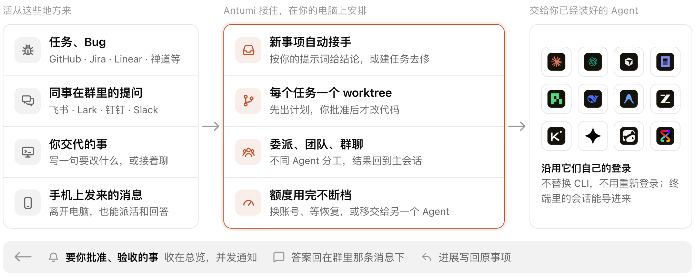
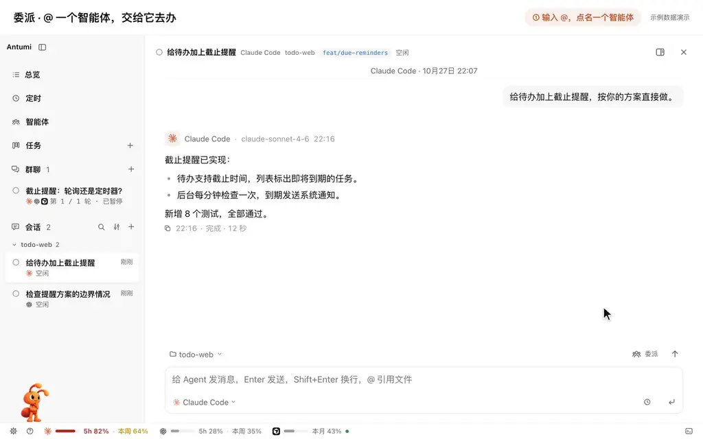
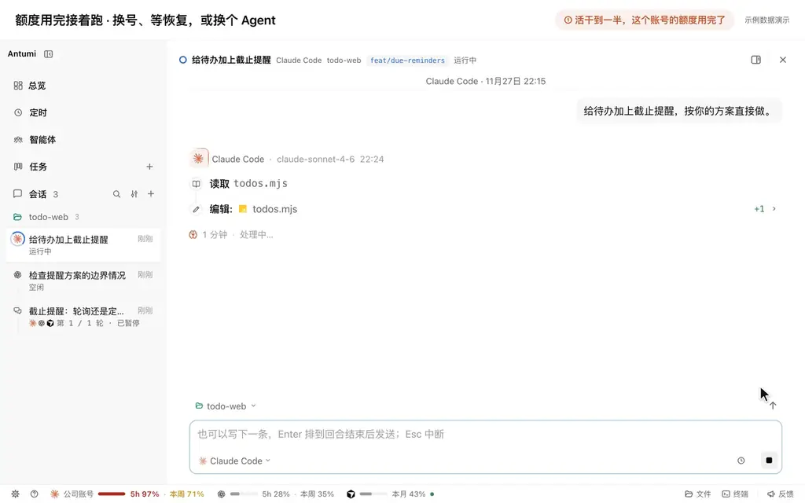
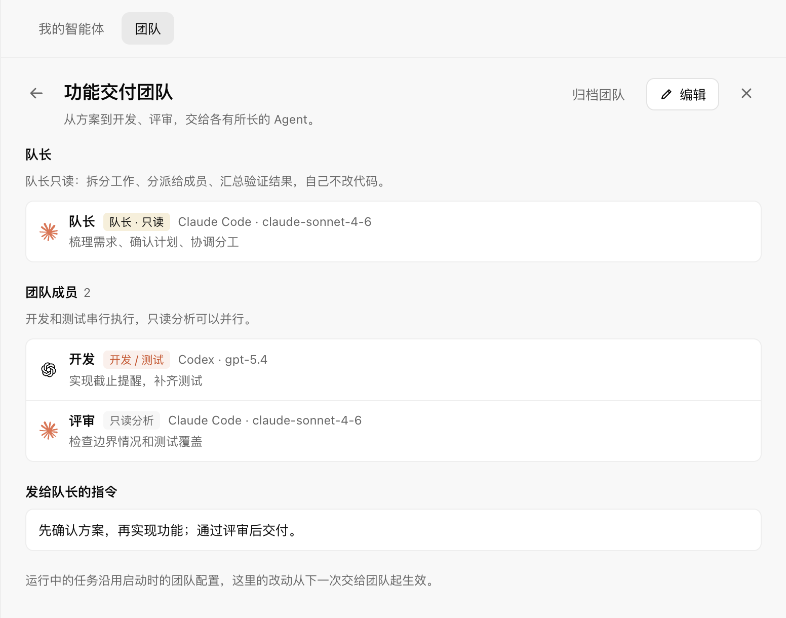
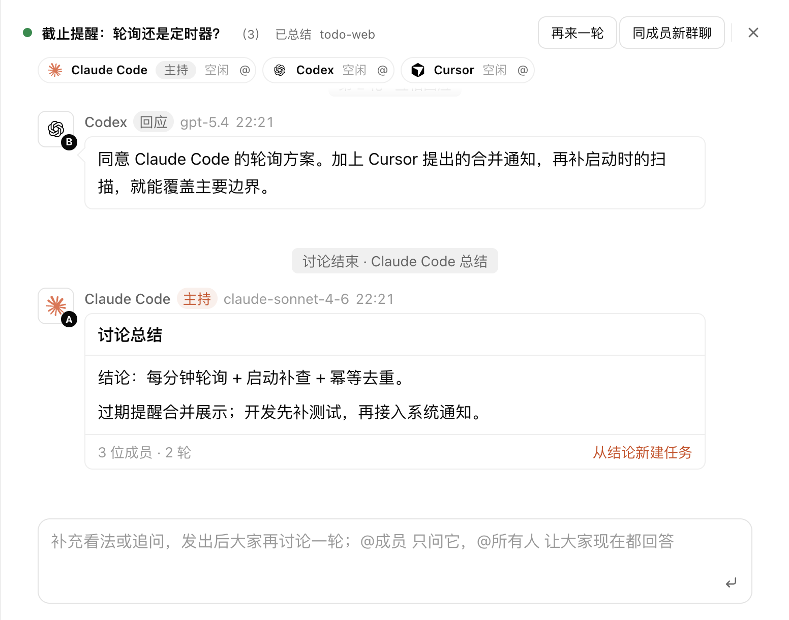

<div align="center">

# Antumi（安图米）

### 你的 Agent，替你值班。

Antumi 是一个桌面工作台：任务和 Bug 进来它先接手，同事在群里问代码它来答，额度用完换号接着跑。<br>用的还是你已经装好的 Claude Code、Codex，不用重新登录。

[](https://github.com/flyhero/antumi/releases)
[](https://github.com/flyhero/antumi/releases)


[](docs/MOBILE.md)

**[下载最新版](#下载) · [三分钟开始](#三分钟开始)**

[它做什么](#它做什么) · [支持的 Agent](#支持的-agent) · [还能做什么](#还能做什么) · [常见问题](#常见问题) · [文档](#文档)

**简体中文** · [English](README.en.md)

<p align="center">
  <a href="#支持的-agent" title="Claude Code"></a>&nbsp;&nbsp;
  <a href="#支持的-agent" title="Codex"></a>&nbsp;&nbsp;
  <a href="#支持的-agent" title="Cursor"></a>&nbsp;&nbsp;
  <a href="#支持的-agent" title="OpenCode"></a>&nbsp;&nbsp;
  <a href="#支持的-agent" title="Pi"></a>&nbsp;&nbsp;
  <a href="#支持的-agent" title="DeepSeek Harness"></a>&nbsp;&nbsp;
  <a href="#支持的-agent" title="Antigravity"></a>&nbsp;&nbsp;
  <a href="#支持的-agent" title="ZCode"></a>&nbsp;&nbsp;
  <a href="#支持的-agent" title="Kimi Code"></a>&nbsp;&nbsp;
  <a href="#支持的-agent" title="Gemini CLI"></a>&nbsp;&nbsp;
  <a href="#支持的-agent" title="CodeBuddy"></a>&nbsp;&nbsp;
  <a href="#支持的-agent" title="CodeArts"></a>
</p>


**一分钟看完：** 三个 bug，从收件箱一路做到合并。

https://github.com/user-attachments/assets/74747188-10e9-4d1d-b444-86c867f25c58

</div>

## 它做什么

你已经在终端里用 Claude Code、Codex 或别的 Agent CLI。Antumi 站在它们前面：把活接进来，分给合适的 Agent，把要你点头的事收到一处。

<picture>
  <source media="(prefers-color-scheme: dark)" srcset="docs/assets/readme/overview-dark.png" />
  
</picture>

下面四件事是主打，点图看大图。其余的见[还能做什么](#还能做什么)，配置步骤都在[使用指南](docs/GETTING-STARTED.md)。

<table>
<tr>
<td width="38%" valign="middle">

### 任务、Bug 进来，自动接手

来源里新来的任务或缺陷，先交给你选的 Agent 看一遍。只给结论还是建任务去修、要不要写回原事项，都由你定。

[接入来源](docs/GETTING-STARTED.md#任务来源) · [事项自动化](docs/SOURCE-AUTO-INVESTIGATION.md) · [回写](docs/SOURCE-WRITEBACK.md)

</td>
<td width="62%">
<a href="docs/assets/features/investigate.webp"></a>
</td>
</tr>
<tr>
<td width="38%" valign="middle">

### 同事在群里问，它替你答

同事在飞书、Lark、钉钉或 Slack 里 @ 智能体，它读代码来回答。只读不改，只看你选的项目，谁问了什么都有记录。

[怎么接](docs/GETTING-STARTED.md#让同事在-slack飞书或钉钉上提问) · [它能碰到什么](docs/CHANNELS.md#信任模型)

</td>
<td width="62%">
<a href="docs/assets/features/channel.webp"></a>
</td>
</tr>
<tr>
<td width="38%" valign="middle">

### 几个 Agent 一起干

打 `@` 把一块活交给另一个 Agent，结果自动回到主会话。活大了交给团队，方案没想清就先开个群聊。

[委派](docs/ARCHITECTURE.md#智能体与委派) · [团队](docs/ARCHITECTURE.md#团队) · [群聊](docs/ARCHITECTURE.md#群聊) · [移交](docs/GETTING-STARTED.md#无缝移交)

</td>
<td width="62%">
<a href="docs/assets/features/delegate.webp"></a>
</td>
</tr>
<tr>
<td width="38%" valign="middle">

### 额度用完，接着跑

有别的账号就自动换号，原会话继续。没有就等额度恢复后接着跑，也可以移交给另一个 Agent。

[多个账号](docs/GETTING-STARTED.md#多个账号) · [预约](docs/GETTING-STARTED.md#预约额度恢复后或到点再发) · [用量统计](docs/USAGE-ANALYTICS.md)

</td>
<td width="62%">
<a href="docs/assets/features/resume.webp"></a>
</td>
</tr>
</table>

<details>
<summary><b>委派、团队、群聊怎么选</b></summary>

| | 委派 | 团队 | 群聊 |
|---|---|---|---|
| **适合** | 交出一块独立的活：审查、补测试、查根因 | 一件要拆开做的事 | 动手之前，先把方案聊清楚 |
| **开始** | 输入框打 `@`，选一个已就绪的 Agent 或存好的智能体 | 把任务交给一个团队 | 新建群聊，选 2–5 个成员 |
| **改代码** | 只读分析，或在独立 worktree 里开发，可以同时进行 | 开发成员改，队长拆分、评审把关 | 都不改，只讨论 |
| **结果** | 自动回到主会话 | 都在同一个 worktree 里，等你验收 | 主持人总结，可以从结论新建任务 |

<table>
  <tr>
    <td width="50%" valign="top">
      <p><strong>团队</strong><br /><sub>队长、开发、评审，各配各的 Agent 和模型</sub></p>
      <a href="docs/assets/readme/squad.png"></a>
    </td>
    <td width="50%" valign="top">
      <p><strong>群聊</strong><br /><sub>各自作答、互相回应，最后由主持人总结</sub></p>
      <a href="docs/assets/readme/discussion.png"></a>
    </td>
  </tr>
</table>

</details>

## 下载

安装包都在 [最新版本](https://github.com/flyhero/antumi/releases/latest) 里，macOS、Windows、Linux 都有，自带运行环境，不需要 Node。

<details>
<summary><b>各系统下哪个文件，第一次打开要做什么（macOS 要先去掉隔离属性）</b></summary>

| 系统 | 下载以它结尾的文件 | 第一次打开 |
|---|---|---|
| macOS · Apple Silicon | `macos-arm64.dmg` | 拖进「应用程序」，再去掉隔离属性（见下） |
| macOS · Intel | `macos-x64.dmg` | 同上 |
| Windows · x64 | `windows-x64.exe` | SmartScreen 拦一下，点「更多信息 → 仍要运行」 |
| Linux · x64 | `linux-amd64.deb`<br>`linux-x86_64.AppImage` | deb 用 `sudo apt install ./文件名` 装；AppImage 加执行权限后运行 |
| Android | `android-arm64-v8a.apk` | 在[手机端的版本](https://github.com/flyhero/antumi/releases?q=mobile-v&expanded=true)里，装好后[和电脑配对](docs/GETTING-STARTED.md#在手机上使用) |

macOS 只有 ad-hoc 签名，装好后先运行一次：

```bash
xattr -dr com.apple.quarantine /Applications/Antumi.app
```

**macOS 通知。** 不要在 dmg 里直接运行，否则系统通知发不出来。第一次发通知时选「允许」；错过了就到「系统设置 → 通知 → Antumi」打开「允许通知」，样式选「横幅」或「提示」。不想敲命令时，可以先双击被拦一次，再去「系统设置 → 隐私与安全性」点「仍要打开」。排查见[打包与安装](docs/ARCHITECTURE.md#8-打包与安装)。

**Linux。** Ubuntu 22.04 及以上用 AppImage 要先 `sudo apt install libfuse2`。Ubuntu 23.10 及以上若报 sandbox 错误，改用 deb，或加 `--no-sandbox`。

**Android。** 很老的 32 位手机装不上 `arm64-v8a` 时，改下 `armeabi-v7a` 那个。

</details>

## 三分钟开始

先装好并登录至少一个 Agent CLI。第一次打开时，Antumi 会检查它们装没装、能不能用。

1. **交一个小任务。** 侧栏「任务」点 +，选项目和 Agent，写一句要改什么，点「开始执行」。Antumi 建好独立的 worktree，Agent 先出计划，你批准后它才改代码。
2. **去忙别的。** 做完或在等你时会发系统通知，等你处理的事都在「总览」里。
3. **验收。** 在右侧检查器看整条分支的 diff，跑项目检查，让 Agent 在内置浏览器里打开页面看一眼。满意了再合并。

接下来想做的事，各看一节：[接 issue 来源](docs/GETTING-STARTED.md#任务来源) · [配多个账号](docs/GETTING-STARTED.md#多个账号) · [接聊天平台](docs/GETTING-STARTED.md#让同事在-slack飞书或钉钉上提问) · [连手机](docs/GETTING-STARTED.md#在手机上使用) · [接编程套餐或自定义接口](docs/GETTING-STARTED.md#模型服务商)。应用里也能从「帮助 → 使用指南」打开。

定时、预约、事项自动化和群里答疑都要电脑醒着才会跑，状态栏的咖啡杯可以保持唤醒。

## 支持的 Agent

十二种：Claude Code、Codex、Cursor、OpenCode、Pi、DeepSeek Harness、Antigravity、ZCode、Kimi Code、Gemini CLI、CodeBuddy、CodeArts。装了哪个用哪个，它们之间都能相互移交，也都能被 `@` 委派。

<details>
<summary><b>各 Agent 的权限模式和支持的功能</b></summary>

| Agent | 常用权限模式 | 计划审批 | 只读委派 | 定时 / 预约 | 多账号换号 |
|---|---|:-:|:-:|:-:|:-:|
| [**Claude Code**](https://github.com/anthropics/claude-code) | 逐项确认 · 自动接受编辑 · 规划 · 自动判断 | ✓ | ✓ | ✓ | ✓ |
| [**Codex**](https://github.com/openai/codex) | 逐项确认 · 自动 · 规划 · 只读 | ✓ | ✓ | ✓ | ✓ |
| [**Cursor**](https://cursor.com/cli) | Agent · Plan · Ask | ✓ | ✓ | — | — |
| [**OpenCode**](https://opencode.ai) | Build · 自动 · Plan · 只读 | — | ✓ | ✓ | — |
| [**Pi**](https://pi.dev) | 默认 · 自动 · 规划 · 只读 | ✓ | ✓ | ✓ | — |
| [**DeepSeek Harness**](docs/DEEPSEEK.md) | 默认 · 自动 · 规划 · 只读 | ✓ | ✓ | ✓ | — |
| [**Antigravity**](docs/ANTIGRAVITY.md) | Default · Auto Edit | — | — | — | ✓ |
| [**ZCode**](docs/ZCODE.md) | 修改前询问 · 自由编辑 · 规划 · 自主 · 只读 | ✓ | ✓ | ✓ | — |
| [**Kimi Code**](docs/KIMI.md)（Node.js 版 2.3.2+） | Default · Plan · Auto | ✓ | ✓ | ✓ | — |
| [**Gemini CLI**](docs/GEMINI.md)（0.66.0+） | Default · Auto Edit · Plan | ✓ | — | ✓ | — |
| [**CodeBuddy**](docs/CODEBUDDY.md) | 每次询问 · 自动接受编辑 · 规划 · 自动审查 | ✓ | — | ✓ | ✓ |
| [**CodeArts**](docs/CODEARTS.md) | Build · 自动 · 规划 · 只读 | — | ✓ | ✓ | — |

- 「只读委派」为 — 的，只能以可改代码的方式被委派。
- 你自己聊的会话里，「全部放行」不会默认选中。定时和预约这类无人值守运行，新安装默认「全部放行」，可在设置 → 权限改成更谨慎的「稳妥」。
- ZCode 用桌面版或 `zcode-app-cli`；Antigravity 在设置 → 外部智能体里下载。那一页还会列出 Antumi 认识、但尚未接入的 Agent CLI。
- 每种 Agent 是怎么接进来的，见[技术架构](docs/ARCHITECTURE.md)和[接入新的 Agent](docs/ADDING-AN-AGENT.md)。

也可以不走官方账号：在设置 → 服务商接入火山方舟、智谱、Kimi 等编程套餐，或自定义接口，已有的 CC Switch 配置能直接导入。Cursor 用不了服务商。通过代理使用订阅账号可能违反服务条款并导致封号，见[使用指南](docs/GETTING-STARTED.md#模型服务商)。

</details>

## 还能做什么

| | |
|---|---|
| **手机端** | 在 Android 手机上看会话、回答确认、发消息和图片、新建和开始任务。Agent 仍在电脑上运行。不在同一个 Wi‑Fi 时可以走 Tailscale 或自己的服务器。[说明](docs/GETTING-STARTED.md#在手机上使用) |
| **定时与预约** | 按每天、工作日或每周跑；也可以把一条消息预约到指定时间。Cursor 与 Antigravity 暂不支持。[说明](docs/GETTING-STARTED.md#预约额度恢复后或到点再发) |
| **智能体** | 把角色、模型、技能和 MCP 存成「我的智能体」，直接聊天、被 `@` 委派或加入团队，还能固定在侧栏。[说明](docs/ARCHITECTURE.md#智能体与委派) |
| **分屏** | 按住 ⌘ 点另一个会话，一边实现，一边看另一个 Agent 的建议。[说明](docs/GETTING-STARTED.md#分屏两个会话并排) |
| **文件、终端、浏览器** | 在工作台里改文件、看开发服务、验证页面。Agent 也能自己打开页面、读控制台。三个面板都能拖成独立窗口。 |
| **小助手与翻译** | 选中一段交给小助手解释，或把回复翻成你的语言。用轻量模型，不占主会话上下文。[说明](docs/GETTING-STARTED.md#小助手与翻译) |
| **待办** | Agent 记下要你之后做的事，在检查器里勾掉；总览汇总所有会话。[说明](docs/ARCHITECTURE.md#待办) |
| **引用与知识库** | 输入框打 `@` 引用文件、项目或以前的会话。Agent 可以把笔记写进你的 Markdown 或 Obsidian 知识库。[说明](docs/GETTING-STARTED.md#跨会话引用) |
| **聊天命令** | 把常用的指令存成命令，最多固定 3 条在输入框上方，点一下就发。 |
| **后端放在别处** | 项目和 Agent 在 WSL 里，或在一台 Linux 服务器上：在设置 → 后端位置把后端挪过去，界面留在本机。[WSL](docs/GETTING-STARTED.md#项目和-agent-都在-wsl-里windows) · [远程服务器](docs/REMOTE.md) |
| **用量** | 统计一段时间内的用量，并估计额度什么时候用完。[说明](docs/USAGE-ANALYTICS.md) |

常用快捷键：看板上 <kbd>N</kbd> 记一条任务，<kbd>⌘</kbd><kbd>K</kbd> 搜索，<kbd>⌘</kbd><kbd>E</kbd> / <kbd>⌘</kbd><kbd>J</kbd> / <kbd>⌘</kbd><kbd>L</kbd> 打开文件、终端、浏览器。都能在设置 → 快捷键里改。

## 数据在哪

- **都在你的电脑上。** 任务、会话和设置存在 `~/.antumi/`。后端只监听 `127.0.0.1`，连它要带本机的 token；打开手机连接后，才另开一个给已配对手机用的端口。
- **密钥单独放。** 任务来源的 token 存在权限 600 的文件里，只交给对应的来源，不会返回给界面，也不会交给 Agent。
- **手机和电脑之间端到端加密。** 经自己的服务器中转时，服务器只转发它看不懂的密文。
- **群里的智能体只读。** 它只能读你选的项目里没被 `.gitignore` 忽略的文件，碰不到这台电脑上别的东西。

细节见[技术架构](docs/ARCHITECTURE.md)、[手机端](docs/MOBILE.md)和[聊天平台接入](docs/CHANNELS.md#信任模型)。

## 常见问题

<details>
<summary><b>要另外买 API 或注册账号吗？</b></summary>

不用。Antumi 用的是各个 Agent CLI 自己的登录和订阅，本身没有账号要注册。想用编程套餐或自定义接口时，再到设置 → 服务商里加。

</details>

<details>
<summary><b>会改我 CLI 的配置吗？终端里还能照常用吗？</b></summary>

能照常用。多账号和服务商都是在每次启动 Agent 时注入环境变量，不改 Agent 自己的配置。终端里聊到一半的会话可以导进 Antumi 接着聊。

</details>

<details>
<summary><b>关掉窗口，Agent 会停吗？</b></summary>

不会。Agent 在后台进程里运行，关掉窗口也不打断它。电脑睡眠时不行：定时、预约、事项自动化和群里答疑都要电脑醒着。

</details>

<details>
<summary><b>有 iOS 版吗？</b></summary>

目前只有 Android 版，APK 在 GitHub Releases 下载，不上应用商店。

</details>

<details>
<summary><b>怎么更新？</b></summary>

macOS 和 Windows 在后台下载新版本，点「安装并重启」或等下次启动时换上。Linux 的 AppImage 也会在后台自动更新；deb 只提示新版本，需要重新下载安装。每个版本改了什么见[更新日志](CHANGELOG.md)。

</details>

<details>
<summary><b>怎么从源码运行？</b></summary>

需要 Node ≥ 22.13 和 pnpm 12。

```bash
git clone https://github.com/flyhero/antumi.git
cd antumi
pnpm install
ANTUMI_HOME=~/.antumi-demo pnpm dev
```

`ANTUMI_HOME` 指到一个测试目录，避免碰到自己的真实数据。打包步骤见[发版与打包](docs/RELEASING.md)。

</details>

## 文档

| | |
|---|---|
| **使用** | [使用指南](docs/GETTING-STARTED.md) · [事项自动化](docs/SOURCE-AUTO-INVESTIGATION.md) · [来源回写](docs/SOURCE-WRITEBACK.md) · [用量账本](docs/USAGE-ANALYTICS.md) · [Markdown 主题](docs/MARKDOWN-THEMES.md) · [更新日志](CHANGELOG.md) |
| **Agent** | [Antigravity](docs/ANTIGRAVITY.md) · [DeepSeek Harness](docs/DEEPSEEK.md) · [ZCode](docs/ZCODE.md) · [Kimi Code](docs/KIMI.md) · [Gemini CLI](docs/GEMINI.md) · [CodeBuddy](docs/CODEBUDDY.md) · [CodeArts](docs/CODEARTS.md) |
| **扩展** | [任务来源插件](docs/PLUGINS.md)：用现成的，或自己写一个 · [接入新的 Agent](docs/ADDING-AN-AGENT.md) |
| **开发** | [参与贡献](CONTRIBUTING.md) · [技术架构](docs/ARCHITECTURE.md) · [聊天平台接入](docs/CHANNELS.md) · [手机端](docs/MOBILE.md) · [WSL](docs/WSL.md) · [远程服务器](docs/REMOTE.md) · [发版与打包](docs/RELEASING.md) · [AGENTS.md](AGENTS.md) · [DESIGN.md](DESIGN.md) |

## 社区与支持

<table>
  <tr>
    <td>
      <strong>微信交流群</strong><br />
      <sub>扫码加入，聊用法、提反馈、看更新。</sub>
      <ul>
        <li><sub>用下来哪里别扭、想接哪个 Agent，欢迎提 <a href="https://github.com/flyhero/antumi/issues">issue</a></sub></li>
        <li><sub>感谢 <a href="https://linux.do">LINUX DO</a> 和 <a href="https://www.v2ex.com">V2EX</a> 社区的支持</sub></li>
      </ul>
    </td>
    <td align="center">
      
    </td>
  </tr>
</table>

## 参与

随着越来越多的小伙伴加入，Antumi 越来越完善。也欢迎你一起来改进它，哪怕只是提一个 [issue](https://github.com/flyhero/antumi/issues)、改一处文档，动手之前可以先看一眼[参与贡献](CONTRIBUTING.md)。期待在贡献者里看到你。

<a href="https://github.com/flyhero/antumi/graphs/contributors">
  
</a>
