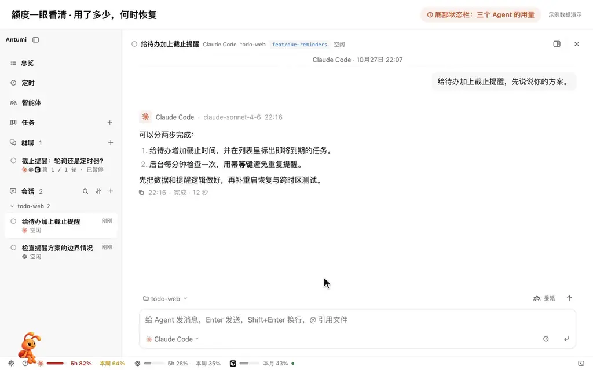
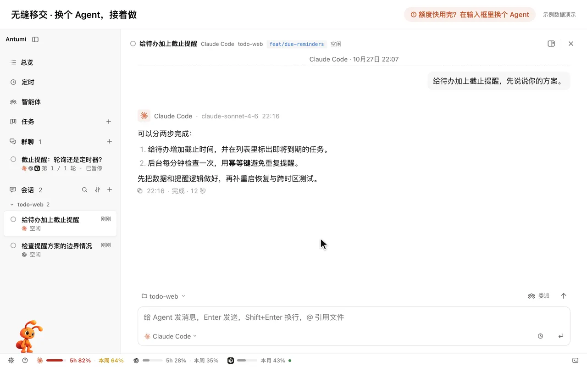
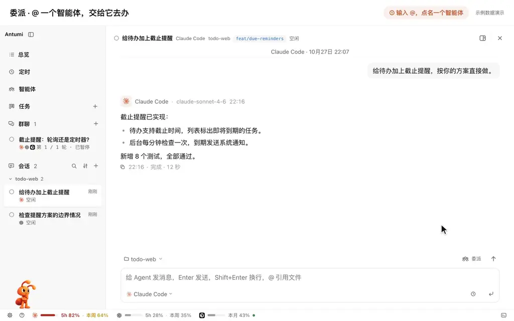
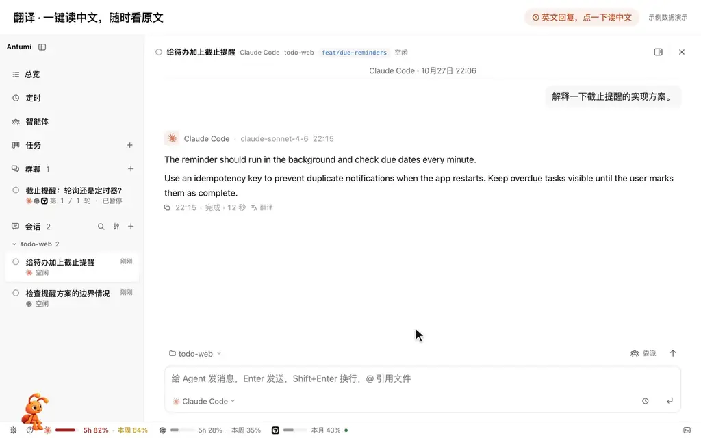
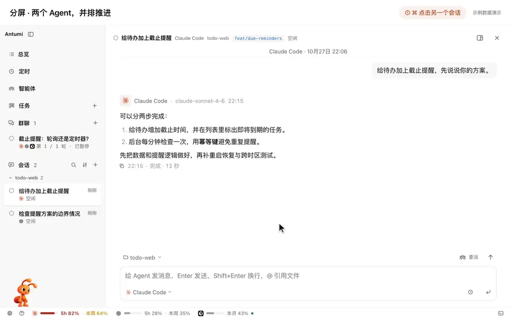
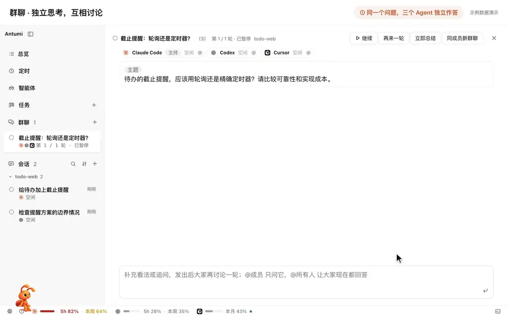
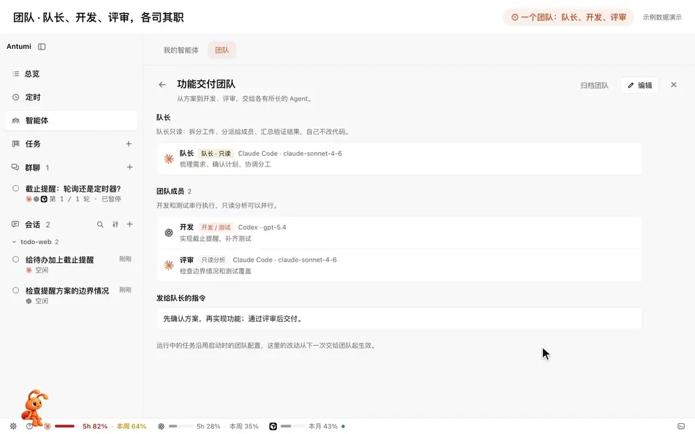
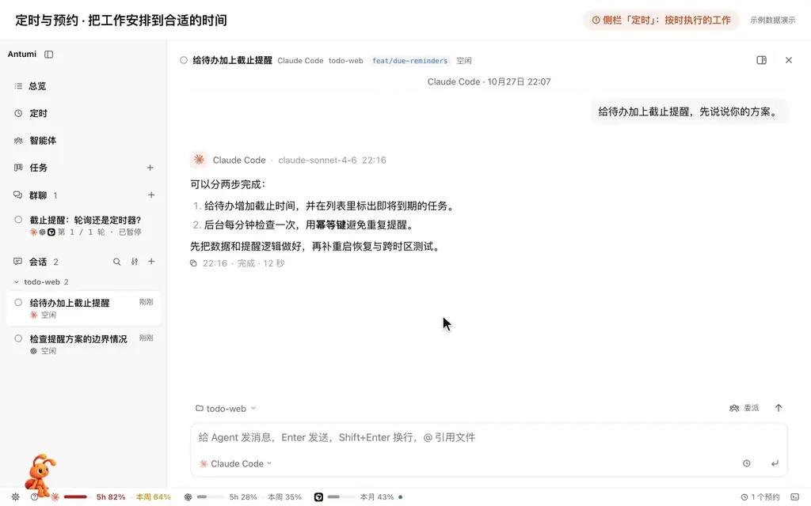
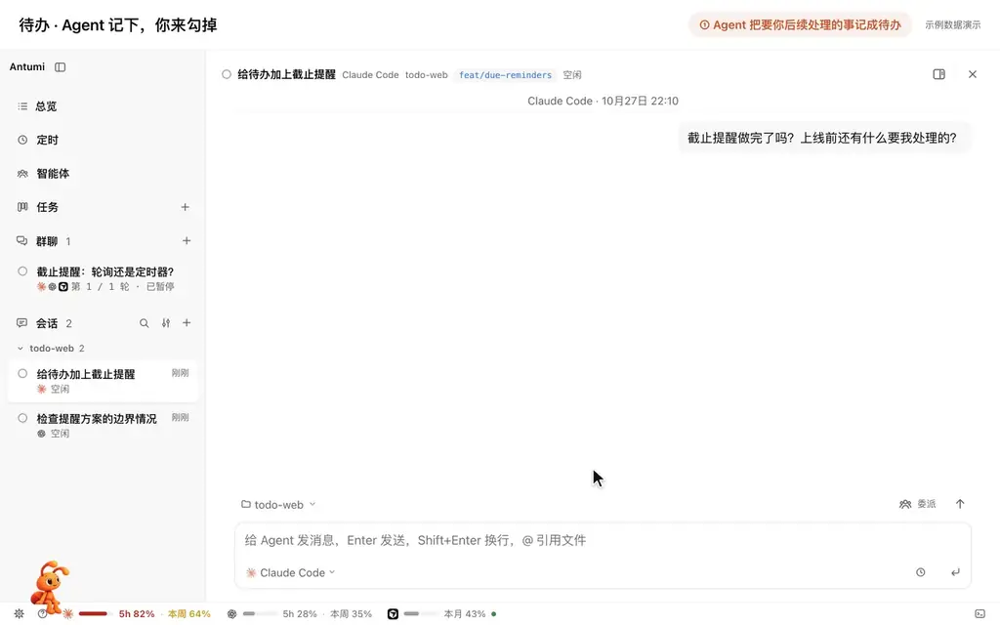

<div align="center">

# Antumi（安图米）

**Claude Code、Codex 等 Agent 照常用，Antumi 帮你省掉在窗口之间复制粘贴的那些活。**

额度看得见 · 用完不断档 · 多个任务并行 · Agent 互相委派

[](CHANGELOG.md)


[下载](https://github.com/flyhero/antumi/releases) · [为什么不只用终端](#为什么不只用终端) · [更多功能](#更多功能) · [快速开始](#快速开始) · [文档](#文档) · [更新日志](CHANGELOG.md) · [反馈](https://github.com/flyhero/antumi/issues)

**简体中文** · [English](README.en.md)

<p align="center">
  <a href="#支持的-agent" title="Claude Code"></a>&nbsp;&nbsp;
  <a href="#支持的-agent" title="Codex"></a>&nbsp;&nbsp;
  <a href="#支持的-agent" title="Cursor"></a>&nbsp;&nbsp;
  <a href="#支持的-agent" title="OpenCode"></a>&nbsp;&nbsp;
  <a href="#支持的-agent" title="Pi"></a>&nbsp;&nbsp;
  <a href="#支持的-agent" title="DeepSeek Harness"></a>&nbsp;&nbsp;
  <a href="#支持的-agent" title="Antigravity"></a>&nbsp;&nbsp;
  <a href="#支持的-agent" title="ZCode"></a>&nbsp;&nbsp;
  <a href="#支持的-agent" title="Kimi Code"></a>
</p>

https://github.com/user-attachments/assets/44398279-8f26-441f-ad24-fa1b1e344674

</div>

## 为什么不只用终端

Antumi 驱动的就是你装好、登录好的 Agent CLI，配置和登录都不用重来，终端里聊到一半的会话也能导进来接着聊。

### 不用再复制粘贴

同时用几个 Agent，很多时间都花在当搬运工上。在 Antumi 里，这些不用你再贴来贴去：

- **在 Agent 之间**：移交带着聊天记录，[委派](#agent-互相委派)的结果自动回到主会话，[群聊](#群聊)里互相回应；Agent 也能自己翻以前和别的 Agent 聊过的会话。
- **报错和运行输出**：Agent 自己在内置浏览器里看页面、读控制台、截图，在内置终端里读开发服务器的输出。
- **任务和 bug**：GitHub、Jira、Linear、禅道的 issue 直接导入成任务；群聊的结论能一键新建任务。
- **代码**：在输入框打 @ 引用文件或项目，不用贴路径和片段。
- **笔记和待办**：Agent 直接把笔记写进你的 Markdown 或 Obsidian 知识库，要你之后处理的事记成[待办](#待办)。
- **看不懂的回复**：选中交给[小助手](#小助手)追问，或者一键[翻译](#翻译)。
- **提示词和配置**：常用指令存成智能体或[定时任务](#定时与预约)；MCP 服务器在一处配好，勾选交给哪些 Agent。

下面四件事，是终端里最常卡住人的地方，其余的见[更多功能](#更多功能)。

### 额度看得见

终端里要等撞上限才知道额度没了。Antumi 底部状态栏常驻 Claude Code、Codex、Cursor、Antigravity、ZCode 的用量，悬停就能看各自的额度窗口和恢复时间。它还按重置时间估算节奏：快重置了还剩很多，就提醒你放心多用；照这个速度会提前用完，就建议换模型，或把轻活交给另一个 Agent。



### 额度用完，工作不停

终端里撞上限，这一轮就停在那儿等你。在 Antumi 里，配了多个 Claude Code / Codex 账号就自动换号，在原会话里接着跑；没有可换的号，就等额度恢复后自动继续；也可以点输入框左下角的 Agent 名称，一键移交给另一个 Agent，它带着聊天记录在同一个目录接着做。



### 多个 Agent 并行做任务

终端里开五个窗口跑五个 Agent，谁在等你批准、谁已经做完，只能挨个切过去看。在 Antumi 里，每个任务一个独立 worktree，代码互不干扰；等你批准、回答、验收的事集中在总览里，Agent 做完或在等你时会发系统通知。


### Agent 互相委派

终端里想让另一个 Agent 帮忙审一遍，只能你在窗口间复制粘贴，再把结论贴回来。在 Antumi 里，把常用角色存成智能体，如代码审查员、测试验证专员，各配外部智能体、模型、技能与 MCP，也可从模板开始；会话里打 @ 点名，主 Agent 也会按需自己调用。被委派的智能体在独立子会话里工作，委派卡片实时显示进度，结果自动回到主会话；只读分析可并行，改代码的委派依次执行、逐项确认。



<sub>我在重度使用多个 Agent 半年后，为解决自己的这些痛点做了 Antumi。</sub>

## 更多功能

[小助手](#小助手) · [翻译](#翻译) · [分屏](#分屏) · [群聊](#群聊) · [团队](#团队) · [定时与预约](#定时与预约) · [待办](#待办)

### 小助手

选中聊天里的一段内容，右键「交给小助手」，它会带着这段引用在右侧打开，帮你解释、追问或处理。小助手默认使用轻量模型、拥有独立上下文，主会话继续专注手头的工作。


### 翻译

英文回复下方点「翻译」就能读中文，再点一下切回原文；也可以只选中一句，右键「翻译」。由轻量模型完成，不占主会话上下文。



### 分屏

按住 ⌘ 点击另一个会话，或在会话菜单里选「在右侧分屏打开」，两个会话就并排显示：一边推进实现，一边看另一个 Agent 的建议。两侧可以分别输入、查看进度和处理批准请求，拖动分隔线就能调整宽度。



### 群聊

让 2–5 个 Agent 在同一条对话里先独立作答，再互相回应，讨论方案的取舍。你可以随时插话或 @ 成员追问，用「继续」「立即总结」掌握节奏，最后由主持人汇总共识与分歧；讨论只读、不改代码。



### 团队

为队长、开发和评审分别配置外部智能体、模型与职责，或直接选用已保存的智能体，然后把一项任务交给整个团队。队长先和你确认计划，再安排成员在同一个 worktree 中协作：开发串行，只读分析可并行。



### 定时与预约

在侧栏「定时」里让 Claude Code、Codex、OpenCode、Pi、DeepSeek Harness 或 ZCode 按每天、工作日或每周执行工作；输入框旁的时钟按钮能把这条消息预约到指定时间或额度恢复后，任务和计划批准也能预约。定时任务可自动选择有额度的 Agent；无人值守时 Agent 问的事由 Antumi 按模式代答，不会停下来等你。电脑需保持唤醒，Cursor 与 Antigravity 暂不支持。



### 待办

Agent 在回复里提到要你之后处理的事（上线前要做的、要你验证或配置的），会记成这条会话的待办，头部检查器按钮上显示未完成数。点开「待办」页签逐项勾掉；「总览 · 待办」汇总所有会话，标着「Agent 可做」的项还能一键交回给 Agent。



<details>
<summary><b>还有这些：从推进任务到验收成果</b></summary>

- **总览**：把等你批准、回答和验收的工作汇在一处，在跑和接下来要做的也一眼看清。
- **任务看板**：支持独立 worktree、多项目任务和前置依赖，验收通过后才解锁后续任务。
- **验收与 Git**：检查整条任务分支的 diff，运行项目检查，支持从远端更新与变基合并。
- **文件、终端与浏览器**：在工作台里编辑文件、管理开发服务，让 Agent 验证页面，你也可以接管。
- **服务商与多账号**：支持第三方编程套餐与自定义模型接口；Claude Code 与 Codex 支持多账号及额度耗尽自动切号。
- **用量分析与预测**：深度账本统计 7/30/90 天用量与额度耗尽预测，定时预热与智能用卡自动化。
- **来源与扩展**：接入 Jira、GitHub、Obsidian、Agent Skills、MCP 服务器与终端会话导入。
- **本地优先**：记录保存在本机，Agent 由后台进程托管，关窗口不中断工作。

</details>

## 支持的 Agent

Antumi 驱动的是你已经装好、登录好的 Agent CLI。

| Agent | 接入方式 | 权限模式 | 计划审批 | 移交 | 定时 / 预约 |
|---|---|---|:-:|:-:|:-:|
| [**Claude Code**](https://github.com/anthropics/claude-code) | `claude -p`（stream-json） | 逐项确认 · 自动接受编辑 · 规划 · 自动判断 | ✓ | ✓ | ✓ |
| [**Codex**](https://github.com/openai/codex) | `codex app-server` | 逐项确认 · 自动 · 规划 · 只读 | ✓ | ✓ | ✓ |
| [**Cursor**](https://cursor.com/cli) | `cursor-agent acp` | Agent · Plan · Ask | ✓ | ✓ | — |
| [**OpenCode**](https://opencode.ai) | `opencode acp` | Build · 自动 · Plan · 只读 | — | ✓ | ✓ |
| [**Pi**](https://pi.dev) | `pi --mode rpc` | 默认 · 自动 · 规划 · 只读 | ✓ | ✓ | ✓ |
| [**DeepSeek Harness**](docs/DEEPSEEK.md) | `dsh --profile antumi`（ACP） | 默认 · 自动 · 规划 · 只读 | ✓ | ✓ | ✓ |
| [**Antigravity**](docs/ANTIGRAVITY.md) | Google 的 Antigravity ACP 服务 | Default · Auto Edit | — | ✓ | — |
| [**ZCode**](docs/ZCODE.md) | `zcode app-server` | 修改前询问 · 自由编辑 · 规划 · 自主 · 只读 | ✓ | ✓ | ✓ |
| [**Kimi Code**](docs/KIMI.md) | `kimi acp`（Node.js 版 2.3.2+） | Default · Plan · Auto | ✓ | ✓ | ✓ |

「全部放行」不会默认选中。设置 → 外部智能体 还会列出 Antumi 认识、但尚未接入的 Agent CLI。

## 快速开始

**前提**：准备好至少一个 Agent（Claude Code、Codex、Cursor、OpenCode、Pi、DeepSeek Harness 请先装好 CLI，ZCode 装好桌面版或 `zcode-app-cli`；Antigravity 可在「设置 → 外部智能体」中一键下载服务并在首聊时登录）。

**从源码运行**，需要 Node ≥ 22.13 和 pnpm 12：

```bash
git clone https://github.com/flyhero/antumi.git
cd antumi
pnpm install
pnpm dev          # 同时启动 daemon、core 和桌面端
```

**打包成 macOS 应用**（Apple Silicon）：

```bash
pnpm dist:mac     # 产物在 packages/desktop/dist/Antumi-<版本>-arm64.dmg
```

**打包成 Windows 安装包**（x64，在 macOS 上也能打）：

```bash
pnpm dist:win     # 产物在 packages/desktop/dist/Antumi-Setup-<版本>-x64.exe
```

装了 App 的机器不需要 Node 和 pnpm。

**在 macOS 上安装 dmg**：App 只有 ad-hoc 签名，没经过 Apple 公证，所以比一般 App 多一步。

1. 打开 dmg，把 Antumi 拖进「应用程序」。不要在 dmg 里直接运行，那样系统通知发不出来。
2. 去掉下载带来的隔离属性，Gatekeeper 才会放行：

   ```bash
   xattr -dr com.apple.quarantine /Applications/Antumi.app
   ```

   不想敲命令的话，也可以先双击被拦一次，再去「系统设置 → 隐私与安全性」点「仍要打开」。
3. 打开 Antumi。它第一次发系统通知时（窗口不在前台，Agent 做完了或在等你），macOS 会问是否允许，选「允许」。这个问题只问一次：错过了或没点，之后的通知只会悄悄进通知中心、不弹出来。这时去「系统设置 → 通知 → Antumi」打开「允许通知」，提醒样式选「横幅」或「提示」。

收不到通知时怎么排查，见[技术架构 · 打包与安装](docs/ARCHITECTURE.md#8-打包与安装)。

**在 Windows 上安装**：安装包没有签名，SmartScreen 会拦一下，点「更多信息 → 仍要运行」。

<p align="center">
  
</p>

<details>
<summary><b>常用快捷键</b></summary>

<br/>

| 按键 | 作用 |
|---|---|
| <kbd>N</kbd>（看板上） | 在「未执行」列顶部快速记一个任务 |
| <kbd>⌘</kbd> <kbd>N</kbd> | 打开完整的新建任务对话框 |
| <kbd>Ctrl</kbd> <kbd>`</kbd> | 打开 / 关闭终端面板 |
| <kbd>Ctrl</kbd> <kbd>Shift</kbd> <kbd>`</kbd> | 打开 / 关闭浏览器面板 |
| <kbd>⌘</kbd> <kbd>,</kbd> | 设置 |
| <kbd>⌘</kbd> <kbd>F</kbd> | 搜索当前聊天 |
| <kbd>⌘</kbd> <kbd>S</kbd> | 保存检查器里正在编辑的文件 |
| <kbd>Enter</kbd> / <kbd>Shift</kbd> <kbd>Enter</kbd> | 发送 / 换行；Agent 忙时 Enter 会把消息排队 |
| <kbd>Tab</kbd> 或 <kbd>→</kbd> | 采用 Claude Code 预测的下一句 |
| <kbd>Esc</kbd> | 中断当前回合；在任务页里回到看板 |

</details>

## 本地优先，安全优先

- **数据在你的机器上**：任务、会话和 worktree 都在 `~/.antumi/`，核心功能不依赖任何 Antumi 托管服务。
- **只对本机开放**：core 只监听 `127.0.0.1`，并且每个连接都要带 token。
- **不经过 shell**：Agent 命令以参数数组启动，prompt 前加 `--`。
- **凭据不外泄**：Jira / GitHub 凭据单独存放（权限 600），不返回给界面，也不交给 Agent。
- **外部内容当作不可信**：导入的 issue 原文包在 `<untrusted-source>` 里交给 Agent；任务图片保存前去掉 EXIF。
- **不替你删成果**：worktree 只在你确认后清理，删前重新检查，有未提交改动或独有提交的一律保留。

## 文档

| 我想…… | 看这里 |
|---|---|
| 了解整体架构、进程边界和通信协议 | [技术架构 · 总体架构](docs/ARCHITECTURE.md#1-总体架构) |
| 弄清任务怎么流转、规划、验收、处理依赖 | [技术架构 · 任务模型](docs/ARCHITECTURE.md#2-任务模型) |
| 管理 worktree、分支、合并冲突 | [技术架构 · Worktree 与 Git](docs/ARCHITECTURE.md#3-worktree-与-git) |
| 了解各 Agent 怎么接入、权限模式对应什么 | [技术架构 · Agent 接入与聊天](docs/ARCHITECTURE.md#4-agent-接入与聊天) |
| 让 Agent 用浏览器验证页面 | [技术架构 · 内置浏览器](docs/ARCHITECTURE.md#5-内置浏览器) |
| 接入任务或 Bug 来源 | [任务来源插件](docs/PLUGINS.md) |
| 写一个任务来源插件 | [插件开发指南](docs/PLUGINS.md#开发一个任务来源插件) |
| 打包、安装、卸载 | [技术架构 · 打包与安装](docs/ARCHITECTURE.md#8-打包与安装) |
| 发布新版本 | [技术架构 · 自动发布](docs/ARCHITECTURE.md#自动发布) |
| 看每个版本改了什么 | [CHANGELOG.md](CHANGELOG.md) |

## 参与开发

先读 [AGENTS.md](AGENTS.md)（进程边界、协议、提交规范）和 [DESIGN.md](DESIGN.md)（视觉规范）。提交前跑：

```bash
pnpm typecheck && pnpm test     # 桌面端改动再加 pnpm build
```

手动试用时别碰自己的真实数据，用测试目录起一套独立实例：

```bash
ANTUMI_HOME=~/.antumi-demo pnpm dev
```

## 现状

Antumi 目前是**开发版**（0.21.x），主要在 macOS 上开发和测试，Windows 可以运行和打包。接下来按优先级：

- **Windows 实机体验**：完善 Windows 上的日常使用、自动更新和 CI。
- **远程执行**：让 Agent 在 SSH / WSL 里的仓库上干活，看板留在本机。
- **更多 Agent 与生态**：持续扩展主流 Agent CLI 与 ACP 生态支持。

用下来哪里别扭、想接哪个 Agent，欢迎提 [issue](https://github.com/flyhero/antumi/issues)。

## 关于名字

**Antumi（安图米）是一个受 ant（蚂蚁）启发的自造词。** 单只蚂蚁很小，合力却能完成大活。Antumi 把不同的 AI 编程 Agent 集中到同一个工作台，让任务分头推进，进度和成果都看得清楚。

## 许可

[Apache License 2.0](LICENSE)
